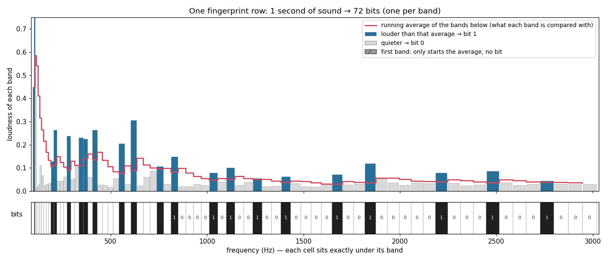
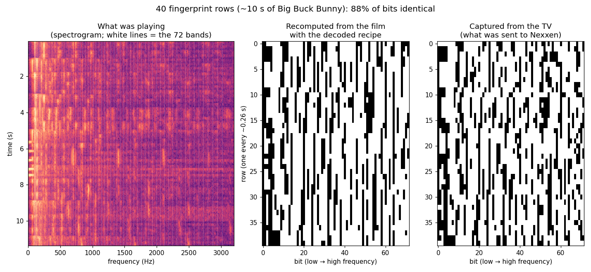

# 01 · Viewing tracking (ACR): `HamService`

## What it is

`/usr/local/bin/HamService` is a native ARM program that ships in the firmware. It starts at boot under its own user (`UhisHam`) and uses about 11 MB of memory. It listens to the TV's sound output, turns it into fingerprints and streams them to Nexxen, an ad company, which replies with what's being watched.

Below are what's in the program, the fingerprint recipe as decoded from its machine code, the messages as captured on the wire, and a check that the decoded recipe reproduces the captured bits from the soundtrack that was playing.

```mermaid
flowchart TB
    subgraph TV
        DEC[Audio decoder<br/>all sources mixed] -->|"ALSA capture, card 0 device 2<br/>48 kHz, 16-bit, stereo"| MONO
        SRC[Source manager] -->|"app name, input,<br/>tuner channel"| POST
        subgraph HAM[HamService]
            MONO[mix to mono] --> FFT["FFT of 1.024 s<br/>every ~0.26 s"] --> BANDS["72 bands<br/>~100 Hz – 3 kHz"] --> BITS["1 bit per band:<br/>louder than the<br/>average below it?"] --> POST["message:<br/>10 rows × 72 bits<br/>+ device ID, time,<br/>app, input, channel"]
        end
        HAM --> OUT[/tmp/acr/tremor_response.txt]
    end
    POST -->|"MQTT v5 over TLS, port 8883<br/>every ~2.7 s while there's sound"| NX[(Nexxen<br/>NN.fp.gb.acr.unruly.co)]
    NX -->|"isMatch, genre<br/>(~every 12 s)"| OUT
```

## Evidence: the process

The open connection ([`connections.txt`](evidence/network/connections.txt)):

```
tcp  <tv-lan-ip>:35126  44.219.84.69:8883  ESTABLISHED  3820/HamService
```

Port 8883 is MQTT over TLS, and the address is Amazon AWS.

As for which sound it captures ([`audio-capture.txt`](evidence/system/audio-capture.txt)): `HamService` holds ALSA capture device `card0 / pcm2c` open and running at 48 kHz, 16-bit, 2 channels. Card 0 is the MStar audio decoder, i.e. the TV's own sound. The microphone is a separate card (card 1), which `HamService` doesn't touch.

Its start script, `/usr/local/scripts/start-hamservice.sh`, sets `NEXN_INPUT_SAMPLE_RATE=48000`, `NEXN_INPUT_CHANNELS=2` and the CA bundle. It has commented-out lines pointing at a staging server, `nexxus-stg.acr.unruly.co`.

The setting is `biz.sl2.acr.switch = 1` ([`privacy-settings.txt`](evidence/settings/privacy-settings.txt)). The program logs `bEnable:%d, bKillSwitch:%d`, so it honours an on/off switch and a remote kill switch.

On 23 November at 11:19, while I was watching something, it wrote this result ([`hamservice-files.txt`](evidence/system/hamservice-files.txt)):

```json
{"isMatch":true,"genre":{"ACR_CAT1":"Series","ACR_CAT2":"Documentary"}}
```

## Two fingerprint engines in one program

The program is stripped of debug symbols, but its dynamic symbol table still names most functions ([`hamservice-functions.txt`](evidence/strings/hamservice-functions.txt)). There are two separate fingerprinters, and Nexxen's backend picks which one to use (`acr_sdk_set_sdk_version_from_backend`, `acr_sdk_v1_*`, `acr_sdk_v2_*`).

| | "Whisper" (`WHSPR_*`, `libnexn`) | "DT" (`DT::acr_processor`) |
|---|---|---|
| Source tree | `/builds/acr/libwhspr/`, `/builds/acr/libnexn/` | `/home/ubuntu/dt-tremor-sdk/` |
| Method | 8 kHz, 4096-sample FFT, 100 bands, "energy regions", MinHash (40 functions) + LSH | 1.024 s FFT, 72–80 bands, one bit per band |
| Settings | `fp_settings:*` (decoded defaults below), `NEXN_FP_*` env vars | none exposed |
| Running on this TV | no | yes: the captured traffic comes from `DT::Proxy::post` |

The rest of this file is about the DT engine, because that's what my TV runs. Whisper's decoded defaults are at the end.

## The fingerprint recipe, decoded

From the ARM disassembly of `DT::acr_processor` (Thumb-2, read with `llvm-objdump`):

The constructor, `acr_processor(sample_rate, channels)`, accepts only 8000, 16000, 32000 or 48000 Hz and 1 or 2 channels. It sets the FFT size to `sample_rate × 1.024`: 49,152 at 48 kHz, which is 1.024 seconds of sound. Every FFT bin is then 1000/1024 ≈ 0.977 Hz wide, whatever the sample rate. It plans a real-to-complex FFTW transform.

`audio_buffer_to_fingerprint(out)`, at `0x8f7d0`:

```
fftwf_execute(plan)
start at FFT bin 100 (byte offset 0x320 / 8), stop at bin 3901 (0x79e8 / 8)
band width starts at 5 bins and grows by 1 for each band   (r7 = 4, r7++)
for each bin: sum += sqrt(re² + im²)                        (abs_fft)
at the end of each band:
    first band: avg = sum                                   (no bit)
    later bands: avg = 0.25 * sum + 0.75 * avg               (d10 = 0.25, d9 = 0.75)
                 bit = (sum - avg > 0)                       (vcmpe / itete)
                 set or clear bit (7 - i%8) of byte i/8      (MSB first)
stop after 80 bits                                          (cmp r8, #0x50)
```

`generate_fingerprint` mixes to mono (`process_audio_bufer_to_mono`), runs the above and passes a 10-byte buffer to a callback. Each row in the captured messages is 72 bits (9 bytes), so the message format keeps the first 72 of the 80 bits. Those cover bands from about 98 Hz to 3 kHz.

Put plainly: for every 1-second slice of sound, the TV records, for each of 72 frequency bands, whether that band is louder than the average of the bands below it. Nothing else goes into the fingerprint. A new slice starts about every 0.26 s, so the slices overlap by three quarters.



The program also checks for silence ("Silence detected (%zu samples), omitting fingerprint"), which is why nothing is sent on a silent screen.

## A captured message

The traffic is TLS-encrypted, but the service trusts whatever CA bundle its start script names. I added my own CA and put a logging relay in between, so I could read the plaintext MQTT ([METHOD](METHOD.md), [`tools/mqtt-tls-relay.js`](tools/mqtt-tls-relay.js)). All 20 captured messages are decoded in [`fingerprint-messages.txt`](evidence/capture/fingerprint-messages.txt), and the session is in [`relay-log.txt`](evidence/capture/relay-log.txt).

The TV connects to `NN.fp.gb.acr.unruly.co:8883`, where NN varies (38, 39, 51), "fp" means fingerprint and "gb" is the country. It verifies the server certificate normally. In the MQTT v5 CONNECT, the client ID and the username are both the TV's device ID (a UUID), and the password comes from registration. It then subscribes to `response/v1/publish_fingerprint/<device-id>`.

Each fingerprint message is 399 bytes, sent every ~2.7 s while there's sound. `DT::Proxy::post` builds it:

| Part | Value |
|---|---|
| Topic | `request/v1/publish_fingerprint` |
| `device_id` | the TV's UUID (version-5 format, derived from a name). The same in every message |
| `request_epoch_timestamp` | Unix time, seconds |
| `request_timezone_offset` | `0` |
| `tv_app_name` | the app on screen, as plain text. In my test it was `test`, the name I'd given the window |
| `tv_source` | input number |
| `tv_tuner_channel` | the channel when on live TV, else `none` |
| `dat_track_info` | `1` on the first message after connecting, then `0` |
| Response topic | `response/v1/publish_fingerprint/<device-id>` |
| Payload | 90 bytes = 10 rows × 72 bits |

The payload is binary and neither compressed nor encrypted (no zlib header; 38% of bits are 1s). Bit-level autocorrelation peaks at a shift of exactly 72 bits, where 83% of bits are identical: consecutive rows overlap. One message:

```
·········████·········██·█···███····██·····█··█·█··██·█·█···█···█···█··█
█████·····███·······█·█··█····██····██·····█····█···█···█·······█··██··█
█████·····█···█·····█····█···█···█···█·····█·██·····██·████·········██··
█████·····█···█··█·······█···█··········█····██····███·████·········██··
█········██···█··█··█····█·█··········█·█··█··█···██······███·······██··
█········██···█···█·█····█·█···█·█····█·█··█··█····█··█·····█·······█···
█········██···█·███······█·█···█·█······█·····█····█·██·····█···█·······
█········██··██·██·······█·█··█··█······█·█···█····█·███····█··██·······
█·········█··██··█··█····█·█··█·······███·····█···██··██··█·█······███··
████····██··█····█·····█·█·····█·····█··█·········██····█·█·█······██···
```

The response comes about every 12 s and is 126 bytes: properties `request_epoch_timestamp` and `error_code = 0`, payload `{"isMatch":false,"genre":{"ACR_CAT1":"no_match","ACR_CAT2":"no_match"}}`. It's the same JSON the TV writes to `/tmp/acr/tremor_response.txt`.

One field the engine does *not* send: the program can accept an HDMI device name (`tv_hdmi_device`), but only the other engine uses it. `DT::Proxy::post` doesn't reference it, and none of the captured messages contain it.

## Check: recomputing the bits from the soundtrack

The capture was taken while Big Buck Bunny (an open film) played. I downloaded the same audio, ran the decoded recipe over it ([`tools/recompute_fingerprint.py`](tools/recompute_fingerprint.py)), and searched for the best alignment of each captured message.

Across all 20 messages (720 bits each), 88.5% of bits are identical; unrelated audio scores about 55%. All 20 messages align to the same point in the film within ±0.1 s, about 59 s in, which matches when I started it. Aligning row by row gives 93% agreement and a row spacing of 0.26 s.

The remaining ~12% is what I'd expect: the TV decodes the film's audio with its own decoder at 48 kHz and applies its sound processing, whereas my copy was decoded on a Mac at 8 kHz.



## What it can and can't reveal

The fingerprint is a picture of the sound, not a hash. Similar sound gives similar bits, which is the point; a hash would scramble them.

It isn't the sound itself either. 72 bits per quarter second is about 267 bits a second. The 8 kHz audio it's made from is 128,000 bits a second, and the most extreme speech codec needs 700. All it keeps is whether each band is louder than the ones below, with no levels, pitch or timing detail. You can't play it back or recover speech from it.

It only listens to the TV's output, not the room. But it is enough to identify a recording. Nexxen computes the same rows for every show, film and ad it indexes and finds where your stream lines up; a few seconds of matching rows is a match.

### Is it like an embedding?

Partly. Each row is a 72-number feature vector, and matching looks for the closest rows, like a similarity search. But nothing is learned. It's a fixed recipe, and it only matches the *same* recording, not "something like" it.

### What it means in practice

Say you're playing on a console plugged into HDMI 2. Messages carry the input number and timestamps, so the session and its length are recorded. Game audio may or may not be in Nexxen's database. If you open a streaming app on the console, what you watch can be matched just as if you'd watched it on the TV. The same goes for a set-top box, a laptop, or any app on the TV. For apps on the TV itself, the app's name is sent too.

## What leaves the TV

All of this was captured with personalised ads switched off on the TV (`biz.sl2.systemctrl.notification.adtarget = 0`). That setting doesn't control ACR. ACR has its own switch (`biz.sl2.acr.switch = 1`) and its own consent from the setup screens (`pn4_enhance = 1` in `/APPS/euladpp/current/eula_dpp_status.ini`, unchanged since setup day).

It goes to Nexxen's MQTT brokers on AWS (`NN.fp.gb.acr.unruly.co:8883`, TLS), plus `acr.unruly.co` for registration, and only while there's sound ([`acr-traffic-count.txt`](evidence/network/acr-traffic-count.txt)):

- silent home screen, 60 s: 0 packets;
- video playing, 30 s: 5,692 bytes out, 1,118 back. That's about 190 bytes a second, one 399-byte message every ~2.7 s plus overhead.

What's sent is the fingerprint rows, the device ID, the time and timezone offset, the app name, the input number, the tuner channel and, implicitly, your IP address.

The TV also has a bundled privacy policy from Alphonso (2020), another ACR company. It says device identifiers "such as IP Address" are kept with the viewing data.

## Not verified yet

- Why messages carry 72 of the 80 computed bits. Most likely the message format truncates each fingerprint to 9 bytes; `DT::fingerprint_size_bytes` is set at runtime.
- What the built-in RSA key (`NEXN_SERVER_PUBKEY`) encrypts. Not the fingerprint messages. Possibly registration, which I didn't capture.
- What's sent for HDMI inputs and live TV (`tv_app_name`, `tv_source`, `tv_tuner_channel` values).
- Whether it stays off. Unticking "Agree to Enhanced Viewing Service" (Settings → Support → Disclaimer and Privacy → Data Sharing, Privacy and EULA) set `pn4_enhance = 0` and every `biz.sl2.acr.*` key to 0 at 12:59:08 on 23 Nov. `HamService` closed its broker connection, and a 60-second count of all its outbound packets read 0. That count was taken on a menu screen, so it should be repeated with a video playing, and after a reboot and a firmware update.
- What `acr.anonymize = 1` does.

## The other engine's defaults ("Whisper")

Decoded from `WHSPR_config_new` / `WHSPR_populate_config` (keys named `fp_settings:*`). My TV doesn't use this engine.

| Setting | Default |
|---|---|
| sample_rate | 8000 |
| window_size / window_overlap | 4096 / 0.96875 (a new spectrum every 16 ms) |
| lower / upper_frequency | 1 / 4000 Hz |
| num_frequency_bands, logarithmic_spacing | 100, no |
| num_min_hash_functions, min_hash_shingle_size | 40, 2 |
| ms_per_hash, ms_per_slot | 1000, 1000 |
| hash_window_ms_server / _device | 250 / 1500 |
| min_region_size | 20 |
| min_similarity_for_match | 0.3 |
| max_hashes_to_post, max_num_db_matches | 500, 100 |
| region_size / energy_delta feature bins | 16 / 16 |

## How to stop it

- In Settings, turn off Viewing Information Services / Enhanced Viewing Service.
- With root, stop `HamService` at boot.
- In DNS or a firewall, block `acr.unruly.co` and `*.fp.gb.acr.unruly.co`.

See [08](08-how-to-turn-it-off.md).
