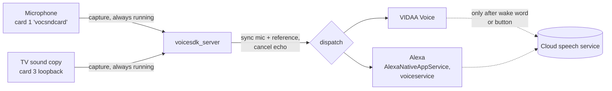

# 02 · Microphone: `voicesdk_server`

## What it is

`/basic/bin/voicesdk_server` runs from boot as user `voicesdk` and uses about 4 MB of memory. It owns the TV's microphone input. It reads the microphone and a copy of the TV's own sound at the same time, then lines the two up so the TV's own sound can be cancelled out of the mic signal (echo cancellation). The cleaned mic audio goes to the voice assistants (VIDAA Voice and Alexa), which listen for a wake word.



## Evidence

The capture devices in use ([`evidence/system/audio-capture.txt`](evidence/system/audio-capture.txt)):

```
card1/pcm0c: RUNNING, process voicesdk_server   ← microphone ("vocsndcard", voc-platform)
card3/pcm0c: RUNNING, process voicesdk_server   ← loopback of the TV's own sound
```

Strings from the program that show what it does ([`voicesdk_server-selected.txt`](evidence/strings/voicesdk_server-selected.txt)):

```
mic pcm pipe %d bytes %d%% ref pcm pipe %d bytes %d%%
sync_mic_ref
dispatch mic data fail
Mic switch
```

The related settings ([`privacy-settings.txt`](evidence/settings/privacy-settings.txt)):

```
biz.sl2.avs.enable = 0                 Alexa not set up
biz.sl2.avs.farfieldPower = 1          hands-free mic powered
biz.sl2.avs.farfieldMute = 0
biz.sl2.avs.farfieldMutePhysical = 0   there is a physical mute state
biz.sl2.vidaavoice.farfieldMute = 1    VIDAA Voice hands-free muted
```

While I looked, neither `voicesdk_server` nor the Alexa processes had any internet connection open ([`connections.txt`](evidence/network/connections.txt)).

## What this means

The microphone stream is open and being read all the time, even though Alexa isn't set up and VIDAA Voice's hands-free mode is muted. I saw nothing leave the TV. Normally a voice assistant only sends audio to the cloud after it hears the wake word or you press the mic button.

This is separate from ACR: `HamService` reads the TV's sound, not the microphone.

## Not verified yet

- Whether this model has a physical far-field microphone or only the remote's mic. The capture device exists and is running either way.
- What happens to the mic audio when both assistants are off: is it discarded, or processed for a wake word?
- Whether anything is sent after a false wake-word trigger.

## How to stop it

In the settings, turn off hands-free voice and Alexa. If the TV has a mic switch, use it; it's usually on the bottom edge near the power light. With root you can stop `voicesdk_server`, `AlexaNativeAppService` and `voiceservice`, though voice search from the remote stops working then.

On my TV I've done the last one, including `voicesdk_server`. It's started once by init at boot (`/etc/init.d/common/init_voicesdk.rc`) with no watchdog, so stopping it is enough; my boot script also swaps it for a stand-in in case anything starts it again ([08](08-how-to-turn-it-off.md)). Afterwards no capture device on the TV was open.
