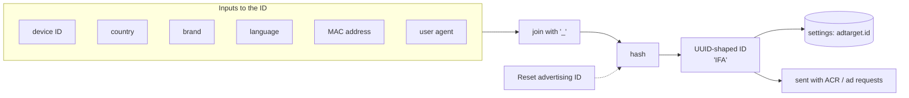

# 03 · Advertising ID and the ad module

## What it is

The TV's interface has a built-in module called `ads`, part of the system UI package `tv.vidaa.app.operationui`. It generates and stores an advertising ID for the TV, and it fetches and shows ads: video ads when apps start, and banners. The advertising ID is what ties viewing data ([01](01-acr-viewing-tracking.md)) to the ads a household gets.



## Evidence

The ID is generated in minified JavaScript in `apps/ads/js/app.js` ([`ads-module-excerpt.txt`](evidence/strings/ads-module-excerpt.txt)):

```js
function _n(){ ... e=[Lt.DEVICE_ID,Lt.COUNTRY,Lt.BRAND,Lt.LANG,C(),E(),qe.getMac(),gs()].join("_"),
  ... t=u()(e).toString() ... Et.info("_genrateIFA",e,r) ... be.setAdId(n) }
```

The inputs are the device ID, country, brand, language, two internal values, the MAC address and the user agent, and the hash is formatted as a UUID. "IFA" is the industry term for it: Identifier For Advertising.

The stored value ([`privacy-settings.txt`](evidence/settings/privacy-settings.txt)):

```
biz.sl2.systemctrl.notification.adtarget = 0
biz.sl2.systemctrl.notification.adtarget.id = <REDACTED>
biz.sl2.systemctrl.notification.advertising = 1
```

The same module names `VASTAdTagURI`, `vastTrack`, `UniversalAdId` (VAST is the standard format for video ads and their tracking pixels), `appStartAds`, `bannerAdsGetten`, `adIdReset`, and the setting `kilby.sl2.i32.system.adtarget.enable`.

On the ACR side, `HamService` has a callback file called `myResetAdidCB`, so it is told when the advertising ID is reset.

## What this means

Because the ID is built from hardware and device identifiers, the MAC address among them, it works as a stable identifier for the TV. Resetting it recomputes it. On my TV `adtarget = 0`, and personalised ads is switched off in the menu, so that's the setting it stores. It doesn't affect ACR, which kept sending fingerprints with it off ([01](01-acr-viewing-tracking.md)). I also run a custom home screen, so I don't get the home-screen banners; a stock TV shows them.

## Not verified yet

- What the two internal inputs (`C()`, `E()`) contribute. One reads the ad configuration file.
- Whether a reset produces a really new ID. If all the inputs stay the same, the hash would too, unless a reset changes one of them.
- Which servers receive the ID.

## How to stop it

- In settings, turn off ad personalisation and reset the advertising ID (in the Ads Privacy app, or under Settings → Privacy).
- Block the VIDAA ad hosts in DNS (`rsc-ads.vidaahub.com`, `rsc-mntz.vidaahub.com`). See [08](08-how-to-turn-it-off.md).
