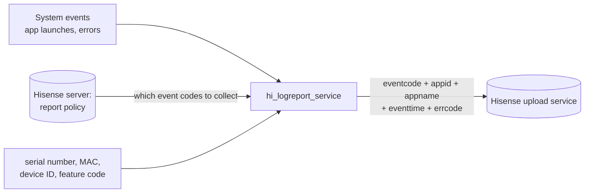

# 04 · Usage logs: `hi_logreport_service`

## What it is

`/usr/local/bin/hi_logreport_service` is a native program that collects event logs on the TV and uploads them to Hisense. It isn't always running like `HamService`; it starts when there's something to report.



## Evidence

Strings from the program ([`hi_logreport_service-selected.txt`](evidence/strings/hi_logreport_service-selected.txt)):

```
%s+eventcode%s+appid%s+appname%s+eventtime%s+errcode%s
Get DeviceSerial [%s], FeatureCode [%s], DeviceId [%s] .
mac: %s.
****** Success to Get Log Report Policy ******
Not Obtain Report Policy, Default Collect Log.
****** Success to Send Upload Log Request ******
Log Upload : Finally upload_serviceUrl = [%s] , upload_serviceUrlHttps = [%s].
post uploadFunctionSwitch success.url is %s, data is %s!
```

The ACR side keeps its own counter as well, in `ACR.ACRLogReportRecord` in the interface's storage, with a count per day.

## How it works

1. It reads the serial number, device ID, "feature code" and MAC address.
2. It downloads a report policy from Hisense that says which event codes to collect. If there's no policy it falls back to "Default Collect Log", so it collects anyway.
3. Each event is recorded as event code, app ID, app name, time and error code.
4. Logs go to a service URL taken from configuration, over HTTP or HTTPS.
5. "Function switch" uploads report changes to feature switches when the TV powers on.

These are usage analytics: what you opened and when, tied to your serial number and MAC. They're less sensitive than ACR because they don't say *what* you watched, but they still add up to a timeline of your TV use under hardware identifiers.

## Not verified yet

- The real upload hostname. It's set at runtime, so it needs catching in a DNS log or `netstat` while the service runs.
- The list of event codes in the policy.
- Whether the "diagnostics" or "improvement" consent switch stops it.

## How to stop it

Turn off usage data / diagnostics / "help improve" in the settings. With root, stop `hi_logreport_service` from starting at boot. Once the upload host is identified it can be blocked in DNS as well.
