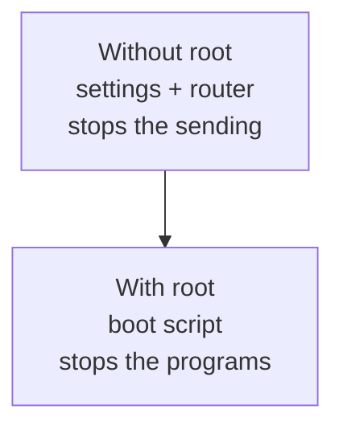

# 08 · Debloating: with and without root

There are two levels. Everyone can do the first with the remote. The second needs a rooted TV, and you should still do the first before it.



## Debloating a TV without root

### 1. Settings

Menu names vary by firmware. These are from my TV (VIDAA U09.60, UK); the [README](README.md#7-where-the-off-switches-are-and-what-each-one-does) has screenshots of every screen.

| Where | Turn off | What it stops |
|---|---|---|
| Support → Disclaimer and Privacy → Data Sharing, Privacy and EULA | *Agree to Enhanced Viewing Service* (then press *Agree*) | the master consent for ACR. Verified: unticking it set every `acr.*` switch to 0, closed the connection to Nexxen and stopped the traffic ([01](01-acr-viewing-tracking.md)) |
| same screen | *Allow Data Sharing to see Ads relevant to you* | sharing your viewing data and device info with third parties for ads |
| System → Advanced Settings → Enhanced Viewing Settings | all five toggles | the individual ACR features. They follow the consent above, but check them |
| System → Advanced Settings | *Personalised Ads*, then *Reset Ads ID* | ads targeted with the advertising ID ([03](03-advertising-id-and-ads.md)). This does not stop ACR |
| System → Advanced Settings | *Personalised recommendations* | the recommendation rows on the home screen |
| System → Voice Service, and the TV's mic switch if it has one | hands-free voice, Alexa | the voice assistants listening ([02](02-microphone.md)) |

On other firmware, look under Settings → System → Privacy or Support → Privacy, and for names like "Viewing Information Services".

Check again after a factory reset or a big update. The setup screens come back, and "Select All", which ticks the tracking too, is the first and highlighted option.

### 2. Router DNS

Ready-made blocklists in every common format, to subscribe to directly: [`lists/`](lists/).

If you run a Pi-hole, AdGuard Home or NextDNS, block:

```
acr.unruly.co
rsc-ads.vidaahub.com
rsc-mntz.vidaahub.com
abtest-tv.vidaahub.com
```

Then an update that quietly re-enables something still can't phone home. Don't block all of `vidaahub.com`: the app store, updates and home screen depend on it. The TV is given its fingerprint server during registration, so blocking `acr.unruly.co` stops new registrations. A TV that's already registered may still reach its server by IP, which is why step 1 matters.

### What this leaves running

Settings stop the sending, not the programs. With everything above done, my TV still had:

- `HamService` running and reading the TV's sound, just not connecting anywhere;
- `voicesdk_server` holding the microphone open;
- Netflix and Prime Video preloaded in the background, about 370 MB between them;
- the log uploader, karaoke and Alexa's services.

That needs root.

## Debloating a rooted TV

### Do the non-root steps first

- Unticking the consent is what VIDAA and Nexxen see. Killing the program only stops it on your TV.
- If your root stops working, after a factory reset or a firmware update that closes the hole, the settings are what's left protecting you.
- The TV's own menus then agree with what's actually running.

### What the boot script does

The system partition is read-only, so nothing can be deleted, and the system's watchdog restarts most of these services if you just kill them. [`tools/debloat.sh`](tools/debloat.sh) runs as root at every boot and works around both:

| Service | How it's handled | Effect |
|---|---|---|
| `HamService` (ACR) | replaced by an idle stand-in, and its user (uid 329) firewalled from the internet | no fingerprinting, nothing reads the TV's sound |
| `hi_logreport_service` | stand-in | no usage logs |
| `karaoke` | stand-in | no karaoke |
| `AlexaNativeAppService`, `voiceservice` | stand-in | no Alexa |
| `voicesdk_server` | stopped (it's started once by init, no watchdog), plus a stand-in in case anything restarts it | microphone closed; no VIDAA voice either |
| Prime Video `ignition` preload | stopped within 5 s of starting | ~246 MB freed |
| Netflix preload and its splash process | stopped within 5 s of starting | ~125 MB freed |

The stand-in is a two-line shell script that sleeps forever. It's bind-mounted over each program, so when the watchdog restarts the service it starts the stand-in, sees a process with the right name, and leaves it alone. Each one uses about 1 MB.

The preload watcher can tell a preload from an app you open yourself. The preloads are started with `--no-resources` (Netflix) and `--launch-in-background` (Prime Video); a normal launch has neither. So both apps still open normally, from cold, a few seconds slower.

I left Matter (smart-home control) and AirPlay alone. On my TV the script took available memory from about 590 MB to 950 MB, and afterwards no process had any audio input open.

### Installing it

How you run something as root at boot depends on how your TV was rooted, so this part is general:

1. Copy `debloat.sh` somewhere writable that allows running programs. `/APPS` works on VIDAA; `/var/local` doesn't (mounted `noexec`). On my TV it lives in `/APPS/.re/debloat/`.
2. Call it from whatever your root method already runs as root at boot. Make the call fail-safe (`[ -x … ] && … || true`) so a problem in it can't break the rest of your boot.
3. Run it once by hand and check the log, `/tmp/debloat.log`. Running it again should change nothing ("already stubbed …").

Check the paths for your firmware first. On mine `/usr/local` is a link to `/mnt/tvroot/usrlocal`, which is why the script recognises its stand-in by the file's contents rather than by the mount table.

### Checking it worked

```sh
cat /tmp/debloat.log                        # what it did this boot
ps | grep -E 'HamService|voicesdk|karaoke'  # stand-ins show up as "/bin/sh …"
for d in /proc/asound/card*/pcm*c/sub0/status; do head -1 $d; done   # all "closed"
iptables -S OUTPUT | grep 'uid-owner 329'   # the firewall rule
```

And for ACR, count packets from the tracker's user while a film is playing:

```sh
iptables -I OUTPUT 1 -m owner --uid-owner 329 ! -d 127.0.0.1   # count only, blocks nothing
sleep 60
iptables -L OUTPUT 1 -v -n -x
iptables -D OUTPUT -m owner --uid-owner 329 ! -d 127.0.0.1
```

Zero is what you want.

### Undoing it

Remove the line that calls the script and reboot. Bind mounts and firewall rules don't survive a reboot, and nothing on the system partition was changed.

### Side effects

- Voice control is gone, Alexa and VIDAA's own. The mic button on the remote does nothing.
- The Enhanced Viewing settings screens talk to a service that's now a stand-in, so they may behave oddly. Leave them off.
- Netflix and Prime Video take a few seconds longer to open.
