# What my Hisense TV does in the background: it fingerprints the sound on every input, HDMI included

## How this started

I bought this TV and got frustrated with it fast. I couldn't install Jellyfin, which is what I use to watch films I own. And the TV was bloated: the home screen had no way of reorganising apps, and it was full of ads and VIDAA promotions I didn't care about.

Then I found [carteakey/alvidaa](https://github.com/carteakey/alvidaa) and started looking into how to fix that. I ended up rooting the TV. I did it by getting a file of my own onto the TV through the browser-facing `fetcher` action, which is a file write that needs no privileges, and then letting the superwatch daemon install it: its `postinst` runs as uid 0. Boot persistence is a vendor js-service, so nothing in the boot chain is modified. A full write-up is here: [55U65QEVS / V0000.09.60A.Q0602](https://github.com/carteakey/alvidaa/pull/82). If you have a VIDAA TV and you're interested in doing the same, I recommend reading that repo.

I'd also recommend doing it with the help of an agentic AI model; I used DeepSeek. But make sure you understand what's happening at each step. Bricking your TV is always a risk with this kind of thing, and rooting it has warranty implications too.

Once that was done, I started looking around the TV for bloat, for fun: removing apps and checking which services were always running. That's when I came across what's in this repo.

I'm as privacy-conscious as the next person. I don't really like ads, but I don't mind watching a few, especially if the service I'm getting is free. Sometimes, though, you have to draw a line on how much data companies collect from something you paid for.

What annoyed me most was this. If I'm playing video games on another input, one that has nothing to do with VIDAA's software, the sound of what I'm playing gets fingerprinted, just because it's coming out of the TV, and sent to an ad company whose business is targeting ads.

So here's what I found, and what I removed from my TV.

The rest of this page is the readable version. The numbered files go into how each part works, with the evidence.

The TV is a Hisense 55U65QEVS (MediaTek MT9618, VIDAA U09.60, firmware V0000.09.60A.Q0602, UK model). I checked all this on 21–23 November 2026.

## The short version

| What | Running on my TV? | Sends data out? | Details |
|---|---|---|---|
| Viewing tracking (ACR). Recognises what's on screen from its sound, on every input. | yes, on since setup (now switched off, see [7](#7-where-the-off-switches-are-and-what-each-one-does)) | yes, to an ad company | [01](01-acr-viewing-tracking.md) |
| Microphone. The built-in mic is read all the time for hands-free voice. | yes | nothing seen | [02](02-microphone.md) |
| Advertising ID and ads. A per-TV ID for ads, plus an ad module. | yes | with ad requests | [03](03-advertising-id-and-ads.md) |
| Usage logs. Which app, what happened, when, tagged with serial and MAC. | on demand | yes, to Hisense | [04](04-usage-logs.md) |
| Always-on cloud links. VIDAA, Netflix and Prime Video stay connected while you're not using them. | yes | yes | [05](05-vidaa-cloud.md), [06](06-preloaded-apps.md) |

The first one is the big one.

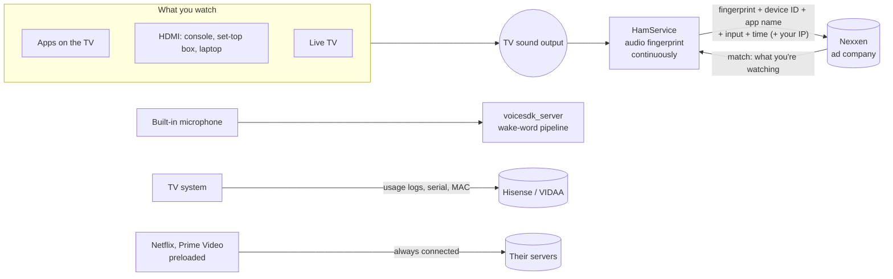

## 1. The TV recognises what you watch, whatever the source

One process, `HamService`, holds a permanent encrypted connection to a server on Amazon's cloud. Inside it is a software kit from Nexxen (formerly Tremor International / Unruly), an advertising company. What it does is automatic content recognition, or ACR.

It runs all the time, and the method is simple. I decoded it from the program's machine code and then checked it against real traffic (below):

1. It taps the TV's sound after the TV has decoded it, so the same sound that goes to the speakers, whatever the source. Not the microphone.
2. Every quarter of a second it takes the last second of sound and splits it into 72 frequency bands, from about 100 Hz to 3 kHz. That's the range where voices and most music live.
3. For each band it asks one yes/no question: is this band louder than the average of the bands below it? That gives 72 bits, one "row".
4. Every ~2.7 seconds it sends the last 10 rows (90 bytes) to Nexxen, along with the TV's device ID, the time, the input, and the name of the app you're in.
5. Nexxen computes the same rows for its library of shows, films and ads, finds where yours line up, and replies.

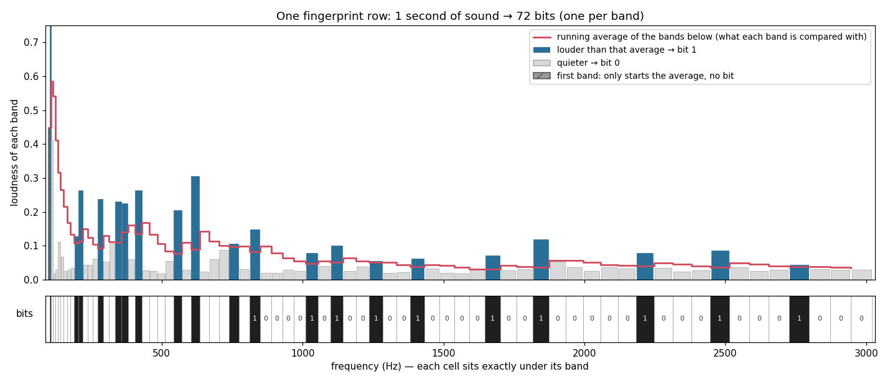

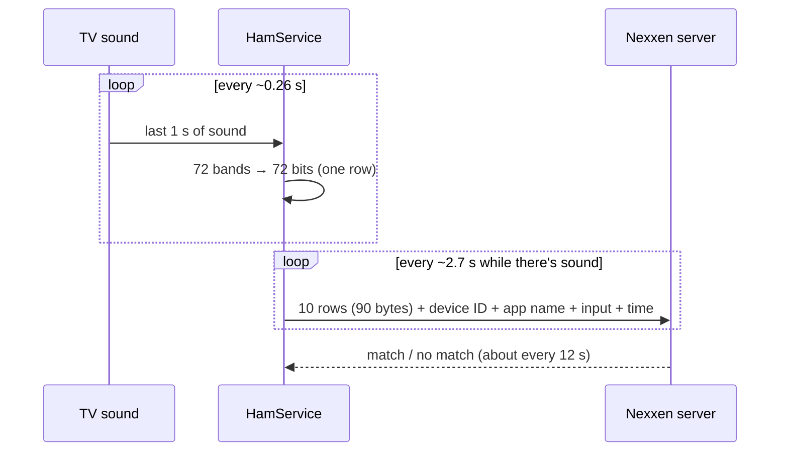

Because it listens to the sound output, it doesn't care where the picture comes from. Say you were playing on a console plugged into HDMI 2. Every message would carry the input number and the time, so the session and how long it lasted are recorded. If you then opened Netflix on the console, the show could be recognised from its sound, just as if you'd watched it on the TV. Same for a cable box, a laptop, or apps I installed myself.

On a silent screen it sends nothing. The program has an explicit check: "Silence detected, omitting fingerprint".

Turning off personalised ads doesn't stop it either. Mine was off the whole time (`adtarget = 0`), and the tracking setting was still on (`acr.switch = 1`, plus the "Enhanced Viewing" consent from setup, `pn4_enhance = 1`). They're separate switches.

### What it actually sends

The connection is encrypted, but the TV is mine. I added my own certificate to the list the service trusts and passed its connection through a small relay that logs each message before sending it on, unchanged (how: [METHOD](METHOD.md)). Here is one real message, sent while a test video played:

```
topic: request/v1/publish_fingerprint
  device_id               = <my TV's unique ID>
  request_epoch_timestamp = 1795436384
  request_timezone_offset = 0
  tv_app_name             = test          ← the name of the app on screen
  tv_source               = 1             ← the input
  tv_tuner_channel        = none          ← the channel, when watching live TV
  payload: 90 bytes, drawn below (█ = 1)

  ·········████·········██·█···███····██·····█··█·█··██·█·█···█···█···█··█
  █████·····███·······█·█··█····██····██·····█····█···█···█·······█··██··█
  █████·····█···█·····█····█···█···█···█·····█·██·····██·████·········██··
  █████·····█···█··█·······█···█··········█····██····███·████·········██··
  █········██···█··█··█····█·█··········█·█··█··█···██······███·······██··
  █········██···█···█·█····█·█···█·█····█·█··█··█····█··█·····█·······█···
  █········██···█·███······█·█···█·█······█·····█····█·██·····█···█·······
  █········██··██·██·······█·█··█··█······█·█···█····█·███····█··██·······
  █·········█··██··█··█····█·█··█·······███·····█···██··██··█·█······███··
  ████····██··█····█·····█·█·····█·····█··█·········██····█·█·█······██···
```

Each line is one row: one second of sound, a quarter of a second after the previous line. Each column is one frequency band, low on the left, high on the right. █ means "louder than the bands below it".

The test video was Big Buck Bunny, an open film, so I could check my decoding: I downloaded the same soundtrack and ran the method over it. 88% of the bits match what the TV sent, and all 20 captured messages line up at the same point in the film. Unrelated audio would match about 55%. The rest of the difference comes from the TV decoding and processing the sound its own way.

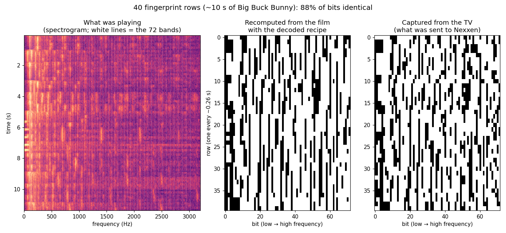

So what's actually in it? A very coarse picture of the sound. It's about 270 bits a second, against about 128,000 for the audio it's made from; even the most extreme speech codec, robotic but understandable, needs 700. There are no volumes, pitches or words, only "this band is louder than the ones below it", 72 times a quarter second. You can't play it back or recover what anyone said. But it's enough to recognise a *recording*: line it up against the same picture of every show and ad, and a few seconds identify it.

Two more things about the message. The app name is sent in plain text. My test video ran in a window I'd named "test", and that's what it reported; in a normal app it would presumably be that app's name, so Nexxen learns which app you use as well as what you watch. And the device ID is the same in every message. It's also the login name for the connection, so every fingerprint is tied to this one TV.

What comes back is Nexxen's answer, which the TV also saves to a file. For the test video it was `{"isMatch":false,...}`, because Nexxen doesn't have that film. Earlier in the day, while I was watching something, it was:

```json
{"isMatch":true,"genre":{"ACR_CAT1":"Series","ACR_CAT2":"Documentary"}}
```

The TV only keeps the genre. Nexxen has the full match.

→ [How it works in detail](01-acr-viewing-tracking.md)

## 2. Who gets it, and why

None of this is accidental. Nexxen has exclusive rights to viewing data from VIDAA TVs (VIDAA is the operating system Hisense uses), runs ad sales on VIDAA in North America until at least 2029, and has invested about $60 million in VIDAA. It sells this to advertisers as "VIDAA ACR data".

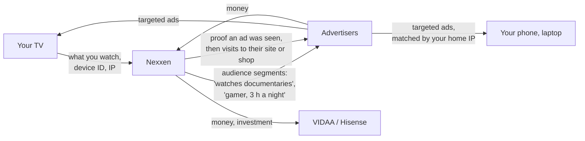

The data goes into household segments ("watches football", "saw the Toyota ad four times this week") used to target ads, both on the TV and on other devices at the same home address. It's also used to prove an ad was seen and then check whether those homes later visited the advertiser's website or shop, and it's sold as ratings-style data about what people watch.

The privacy policy bundled on the TV says so directly. It collects "regardless of the source (e.g., TV, video and audio streaming devices, set-top boxes, etc.)", keeps device identifiers "such as IP Address" with the viewing data, and uses it for ads "both to your Smart TV as well as to other devices that are connected to your Smart TV". Oddly, that bundled text is from Alphonso, a different ACR company, dated 2020, while the code is Nexxen's.

I'm not the first to notice. In December 2025 the Texas Attorney General sued Hisense, Samsung, LG, Sony and TCL over ACR, and got a temporary court order stopping Hisense from collecting this data from Texans. A 2024 university study of Samsung and LG TVs found the same tracking running on HDMI inputs.

## 3. The microphone is open

A second process, `voicesdk_server`, keeps the TV's built-in microphone input open, along with a copy of the TV's own sound to cancel echo. That's how hands-free voice works: something has to listen for the wake word.

On my TV, Alexa isn't set up and VIDAA Voice's hands-free mode is muted, but the microphone is still being read. I saw no voice process with an internet connection open, so as far as I can tell nothing leaves the TV. Still, it's a microphone in the living room that's always being read.

→ [02-microphone.md](02-microphone.md)

I've since removed voice entirely on my TV: Alexa's two processes and `voicesdk_server`, the microphone pipeline behind VIDAA's own assistant. Nothing on the TV has the microphone open now. → [08](08-how-to-turn-it-off.md)

## 4. An advertising ID, and an ad module

The TV makes itself an advertising ID derived from its device ID, MAC address, country, brand and language. That ID is what ties your ACR profile to the ads you get. The built-in ad module can show video ads when apps start and banners on the home screen.

→ [03-advertising-id-and-ads.md](03-advertising-id-and-ads.md)

## 5. Usage logs

`hi_logreport_service` uploads event logs to Hisense: which app, what happened, when. Each log is tagged with the TV's serial number, MAC address and device ID. What it collects is set by a policy it downloads from Hisense.

→ [04-usage-logs.md](04-usage-logs.md)

## 6. Apps you never opened, using memory you paid for

This TV has **2.6 GB of RAM** in total. That has to hold Linux, the TV's own interface, the video decoder, a full Chromium browser (every "app" on VIDAA is really a web page) and whatever you're actually watching. When I measured it, with the TV sitting on the home screen, only **about 580 MB was available**.

Out of that same 2.6 GB, these were running even though I hadn't opened any of them:

| Running in the background | Memory | Opened? |
|---|---|---|
| Prime Video (`ignition --launch-in-background`) | 246 MB | no |
| Netflix (`netflix` + its splash screen) | 125 MB | no |
| Alexa (`AlexaNativeAppService` + `voiceservice`) | 63 MB | not even set up |
| Smart-home (Matter), AirPlay, karaoke | 64 MB | depends on you |
| The tracking and log services from sections 1 and 5 | 24 MB | never asked for |

Netflix and Prime alone take about **370 MB**. That's 14% of the TV's memory, or more than half of what was left free, held permanently so that two apps open a few seconds faster. Both also stay connected to their own servers on Amazon's cloud the whole time. And Netflix sends some DNS lookups straight to Google's 8.8.8.8 rather than through your router.

Why it matters for performance is visible in the browser's own launch settings ([`memory.txt`](evidence/system/memory.txt)). VIDAA forces it into **"low-end device mode"** and tells it to start shedding memory when free memory drops below 450 MB, and harder below 200 MB. It also caps the buffer for streaming video at 80 MB. When memory runs short, a few things happen:

- the browser drops pages and cached data, so apps reload when you switch back to them, and the TV can show its "memory is high" prompt;
- streaming apps get less room to buffer ahead;
- the system starts compressing memory into its 1.5 GB zram swap. That trades RAM for CPU on a fairly slow chip (four 1.4 GHz cores), which you feel as stutter in the menus;
- in the worst case Linux kills a process to make room, usually one of the biggest, which can be the app you're using.

To be fair to Hisense, my own setup adds to this. When I measured, the biggest single process was the torrent engine of the Stremio-style app I installed (about 500 MB while streaming; it shuts down after 20 idle minutes). But that's exactly the point: memory I want for something I'm actually using is being held by apps I'm not.

The VIDAA system itself also keeps a permanent connection open to a server in Singapore, and its code talks to VIDAA services for A/B testing, recommendations, ads, "monetisation" and file uploads. Some of that is needed for the app store and updates. → [05](05-vidaa-cloud.md), [06](06-preloaded-apps.md)

## 7. Where the off switches are, and what each one does

There isn't one privacy switch. There are five places, in two different menus, with names that don't say what they do. I went through all of them with the remote, on the TV as it ships (no root needed for any of this), and turned everything off. The screenshots are from my TV, VIDAA U09.60, UK.

**System → Advanced Settings** has three separate options:

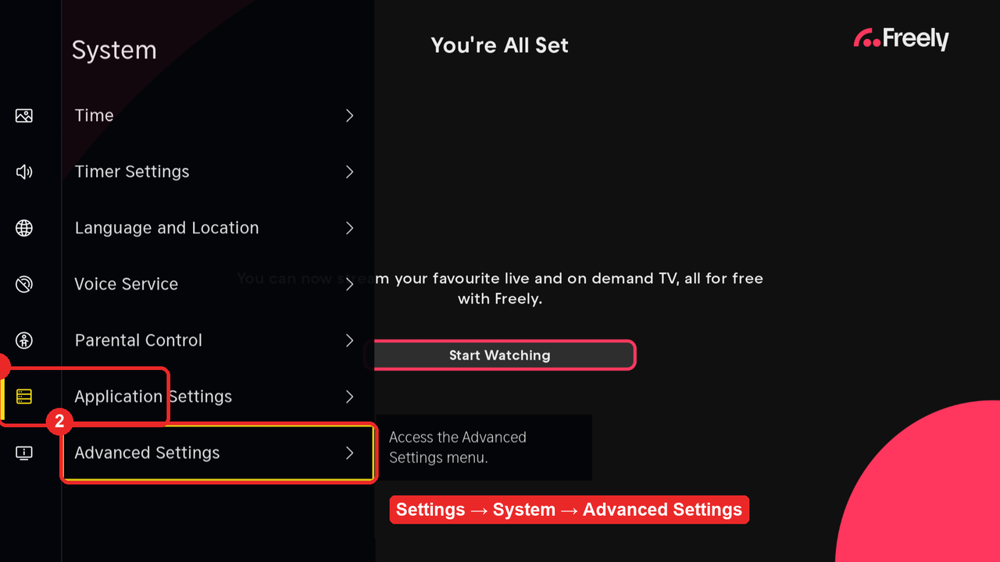

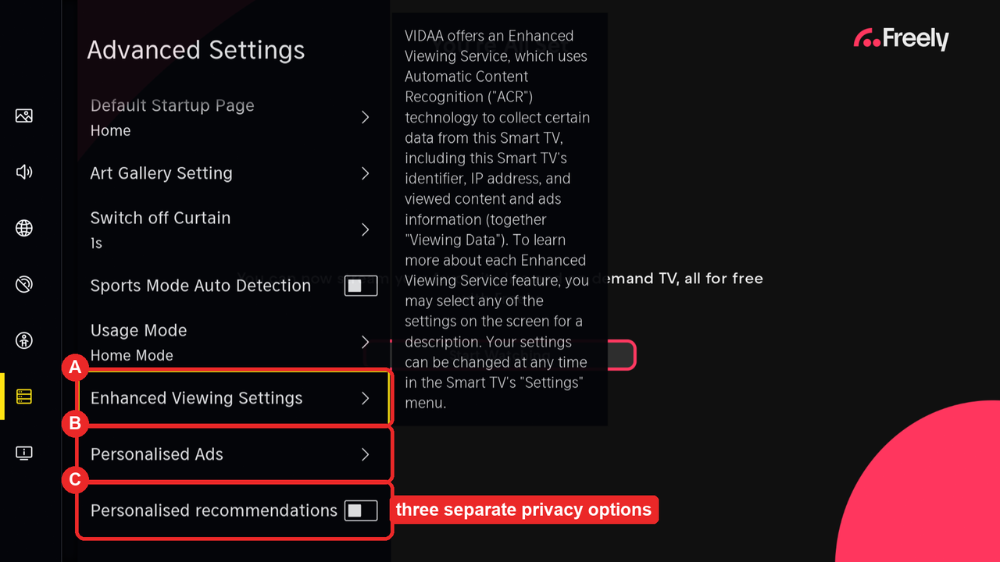

**A. Enhanced Viewing Settings** opens a page of five toggles. This is where the fingerprinting lives:

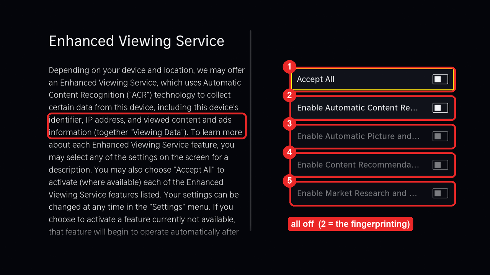

1. *Accept All* turns on 2–5 in one go.
2. *Enable Automatic Content Recognition* is the fingerprinting itself (`acr.switch`). The page says it collects "this device's identifier, IP address, and viewed content and ads information". Options 3–5 need it on.
3. *Enable Automatic Picture and Audio Quality* uses the recognised content to tweak picture and sound (`acr.aiaqpq`). This is why Nexxen's answers include a genre.
4. *Enable Content Recommendation* recommends things based on what it recognised you watching (`acr.recommendation`).
5. *Enable Market Research and Personalized Ads (Requires ACR to be enabled)*. Its description is the only place in the menus that names the company: "VIDAA is engaging Nexxen to enhance and enable the personalized ads experience", with a link to the list of Nexxen's data partners.

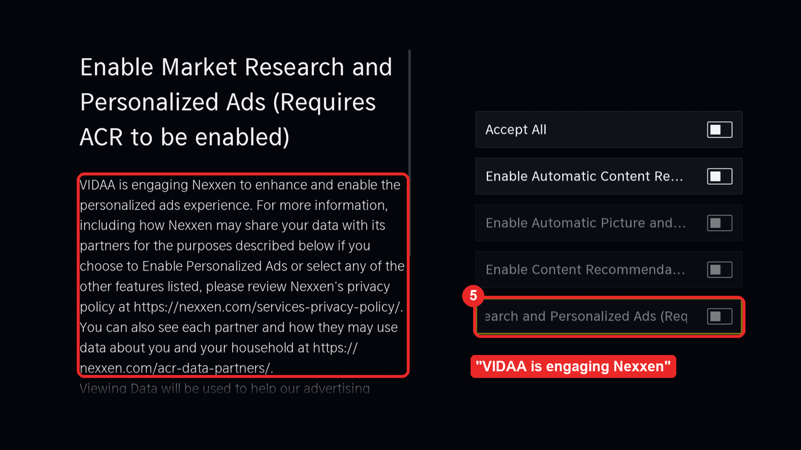

**B. Personalised Ads** is a different thing. It controls whether ads are targeted using the TV's advertising ID (`adtarget`). The TV itself says turning it off "will not reduce the number of ads you receive". It doesn't touch ACR. I had this off and the fingerprints were still being sent.

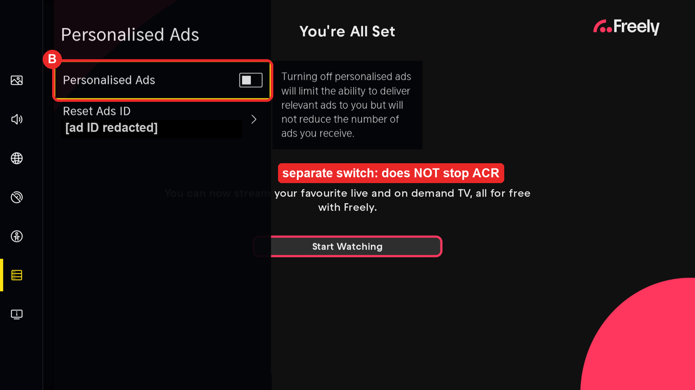

**C. Personalised recommendations** controls the recommendation rows on the VIDAA home screen. It was already off on mine. I couldn't tie it to a specific setting key, so I can't say exactly what data it uses.

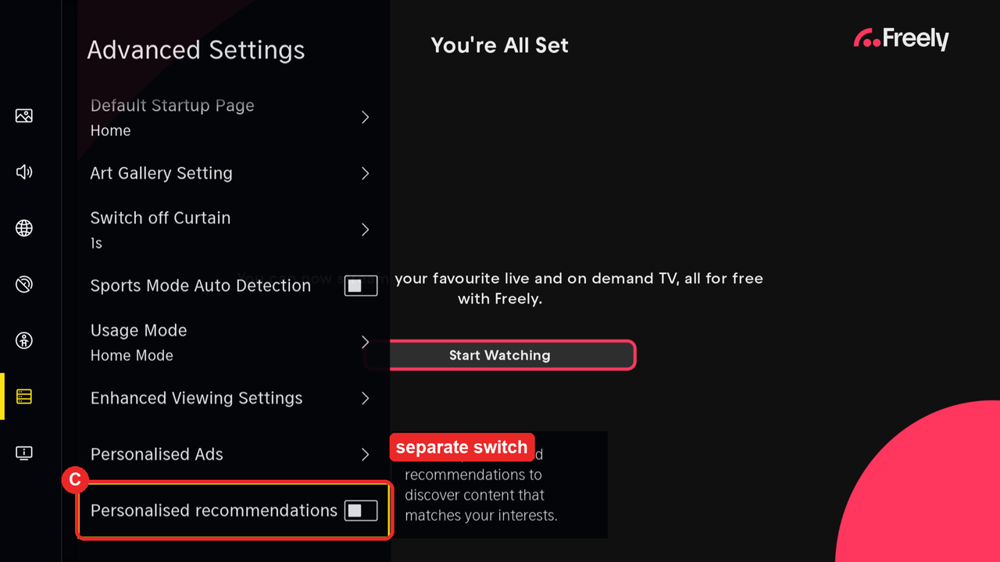

**Support → Disclaimer and Privacy → Data Sharing, Privacy and EULA** is the second menu. It's the same checkbox screen you get in the setup wizard:

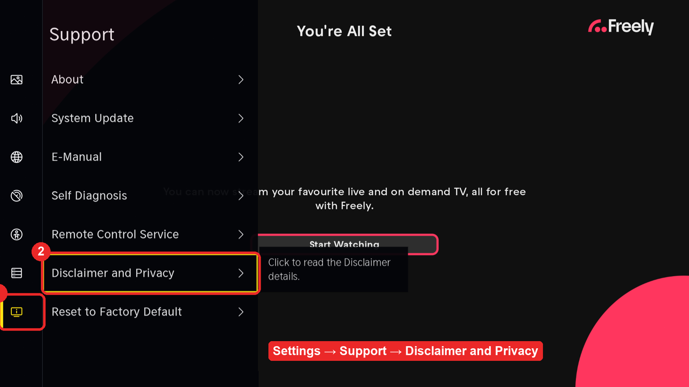

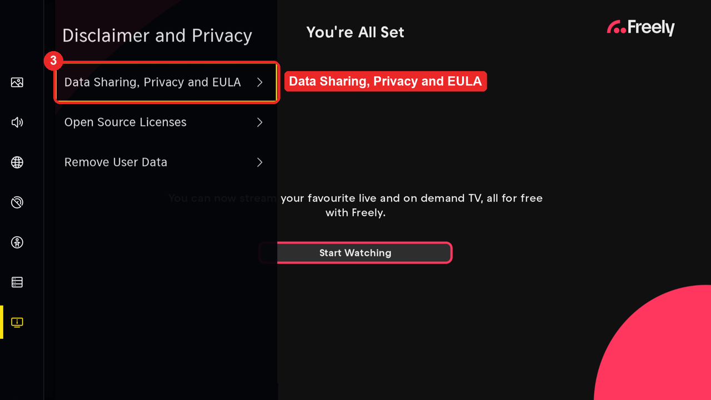

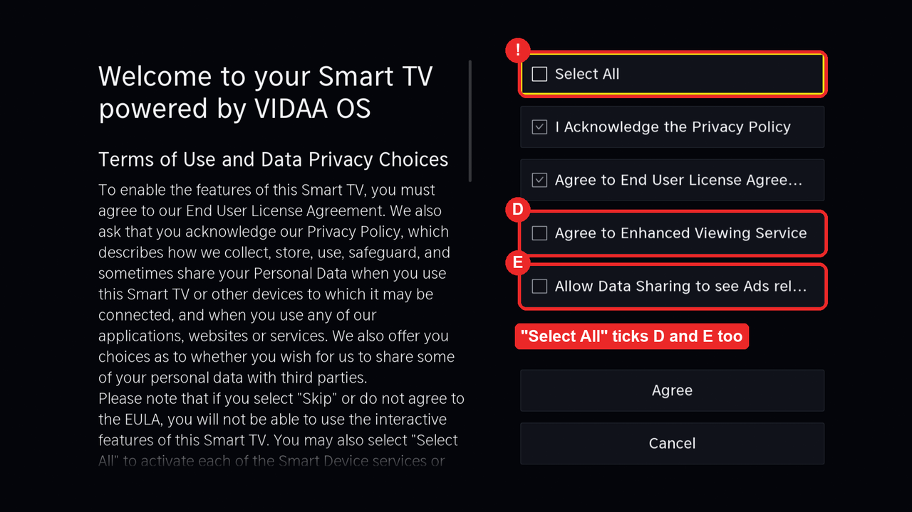

**D. Agree to Enhanced Viewing Service** is the master consent for everything under A (`pn4_enhance`). This is the one that had been ticked since I set the TV up. Its description says the viewing data is used "to enable our advertising partner Nexxen to create a personalized ads profile about you".

**E. Allow Data Sharing to see Ads relevant to you** (`pn9_datasharing`) lets VIDAA share viewing data and device information with third parties for ads. Mine was off.

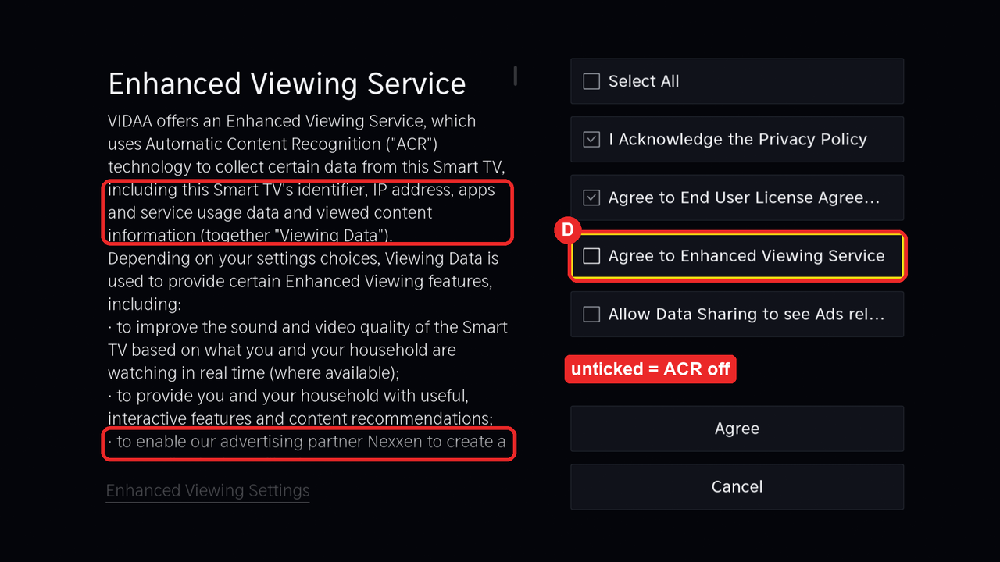

A few things about this layout bother me:
- **The two switches for the same thing are in different menus.** D (under Support) and A2 (under System) both turn ACR on, with different names: "Enhanced Viewing Service" in one, "Automatic Content Recognition" in the other. Unticking D switched every `acr.*` key to 0, A2 included.
- **"Select All" is the first item on the setup screen.** It's highlighted when the page opens and ticks D and E along with the agreements you actually need.
- **Nothing in the names says "advertising".** "Enhanced Viewing" sounds like a picture setting, and Nexxen is only named deep inside a description you have to scroll to. The Texas lawsuit makes the same complaint about the label.

When I unticked D, the TV recorded the opt-out within a second (`pn4_enhance` 1 → 0, all `acr.*` switches → 0), and `HamService` dropped its connection to Nexxen. In the next minute it sent nothing at all. Its last answer, written four seconds before I unticked it, was another match: `{"isMatch":true,"genre":{"ACR_CAT1":"Series","ACR_CAT2":"Auction"}}`.

**The process is still alive, though.** With everything off, `HamService` keeps running and keeps reading the TV's sound. It just doesn't connect anywhere. So the settings stop the sending, not the program, and an update or a re-ticked box turns it straight back on. That's why I'd also block its servers (see [08](08-how-to-turn-it-off.md)).

## What isn't spyware

To be fair, plenty of things that look suspicious aren't, like the USB media indexer, the screenshot service and AirPlay. → [07](07-what-isnt-spyware.md)

## Debloating a TV without root

Anyone can do this with the remote. It doesn't remove anything, but it stops the TV sending what it collects, and that's most of the privacy problem.

1. **Settings → Support → Disclaimer and Privacy → Data Sharing, Privacy and EULA.** Untick *Agree to Enhanced Viewing Service* and *Allow Data Sharing to see Ads relevant to you*. Leave the Privacy Policy and EULA ticked (the TV needs them), and press *Agree* to save. This is the one that actually stopped the fingerprinting on mine.
2. **Settings → System → Advanced Settings.** Check that everything inside *Enhanced Viewing Settings* is off, then turn off *Personalised Ads* (and reset the ads ID) and *Personalised recommendations*.
3. **Voice.** If you don't use it, turn off hands-free voice and Alexa, and use the mic switch on the TV if yours has one.
4. **Apps.** Remove the app tiles you don't use from All apps. Most of them are just web shortcuts, so this only tidies the menu.
5. **Your router.** If you have a Pi-hole, AdGuard Home or NextDNS, block `acr.unruly.co` and VIDAA's ad hosts. Then an update that quietly flips a setting back on still can't phone home.

The screenshots for 1 and 2 are in [section 7](#7-where-the-off-switches-are-and-what-each-one-does).

What this doesn't do: the programs keep running. The tracker stays in memory listening to the TV's sound, just without sending; the microphone pipeline stays open; Netflix and Prime stay preloaded and keep their ~370 MB. A factory reset or a big update can also bring back the setup screen, where "Select All" is the first and highlighted option. So check again after updates.

Watch out for the trap I fell into: *Personalised Ads* and the tracking are separate switches. I had turned off personalised ads and thought that covered it. Every fingerprint in this repo was captured with it off.

## Debloating a rooted TV

Do all of the steps above first, even with root:
- unticking the consent is what tells VIDAA and Nexxen you opted out. Killing the program only stops it on your side;
- if your root ever stops working, after a factory reset or a firmware update that closes the hole, the settings still protect you;
- the TV's own menus stay consistent with what's actually running.

Then, with root, the programs themselves can go. The system partition is read-only, so nothing is deleted. Instead my boot script ([`tools/debloat.sh`](tools/debloat.sh)) runs as root at every boot and:

- replaces the tracker, the log uploader, karaoke, both Alexa processes and the VIDAA voice/mic service with a 1 MB do-nothing stand-in of the same name, so the system's watchdog thinks they're running and stops restarting them;
- stops the Netflix and Prime Video background preloads the moment they start, while leaving the apps alone when you open them yourself;
- firewalls the tracker's user from the internet, in case the stand-in ever fails.

On my TV, the script took available memory from about 590 MB to 950 MB, and nothing has an audio input open any more. Undoing it is one line and a reboot. How to install it, check it worked and undo it: [08](08-how-to-turn-it-off.md#debloating-a-rooted-tv).

## How this was checked

Everything here comes from the TV itself: running processes, open network connections, which process holds which sound device, the settings file, and text inside the programs. The network traffic is encrypted, so I can say where it goes and when, but not always exactly what's in it. → [METHOD.md](METHOD.md)

The raw evidence is in [`evidence/`](evidence/). Identifiers (advertising ID, MAC, serial, local IPs) are redacted. No vendor programs are included, only short excerpts and their SHA-256 hashes.

## Sources

- Nexxen, [VIDAA ACR data](https://nexxen.com/acr-data/) and [VIDAA ACR (APAC)](https://pages.nexxen.com/en/vidaa-acr-apac)
- PPC Land, [Nexxen renews partnership with VIDAA](https://ppc.land/nexxen-renews-partnership-with-vidaa-for-north-american-ctv-expansion/)
- Digiday, [Nexxen and Hisense](https://digiday.com/media-buying/nexxen-and-hisense-open-up-smart-tv-programmatic-floodgates)
- Hisense USA, [Enhanced Viewing Service privacy notice (2025)](https://www.hisense-usa.com/compliance/enhanced-viewing-service-privacy-notice-(effective-date:-march-01,-2025)) and [the 2023 version naming Tremor Video](https://www.hisense-usa.com/compliance/enhanced-viewing-service-privacy-notice-(effective-date:-april-30,-2023))
- Willkie Farr & Gallagher, [Texas AG obtains TRO against Hisense](https://complianceconcourse.willkie.com/articles/texas-ag-obtains-tro-to-prevent-hisense-from-collecting-consumers-viewing-information-through-its-smart-tvs/)
- TechRadar, [Texas sues LG, Samsung, Hisense, TCL and Sony](https://www.techradar.com/televisions/your-tv-is-a-mass-surveillance-system-says-texas-and-the-state-is-suing-lg-samsung-hisense-tcl-and-more-to-stop-it)
- IAPP, [ACR takes the privacy enforcement spotlight](https://iapp.org/news/a/automated-content-recognition-technology-takes-privacy-enforcement-spotlight)
- heise, [Smart TVs even track console gamers](https://heise.de/-9994920), on the 2024 study
- RTINGS, [Testing smart TV tracking](https://www.rtings.com/tv/learn/research/smart-tv-tracking)
